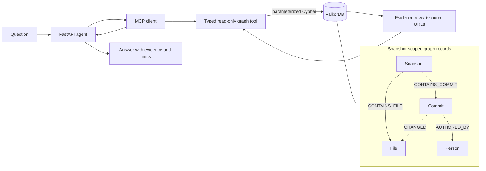

# RepoBrain

RepoBrain is an evidence-backed engineering agent that uses FalkorDB to reason over a public Python repository. Its UI combines answer summaries, tenant-scoped memory, change details, source records, and a query-scoped interactive 3D relationship explorer.

## Why FalkorDB is essential

RepoBrain does not ask the language model to guess repository facts from a text
dump. A typed, read-only MCP tool runs a parameterized graph traversal in
FalkorDB, returns matching entities and provenance, and the answer layer
summarizes only that evidence. For example, contributor history follows a
snapshot through commits to files, then follows authorship to people. The query
also returns source commit/file URLs and recorded change summaries.



The selected tool, snapshot ID, parameters, evidence rows, and source URLs are
exposed in the UI's reasoning/evidence panels. The LLM is the presentation
layer; FalkorDB supplies repository facts and relationship paths.

## Project location

The canonical working copy for this project is:

```text
D:\projects\RepoBrain
```

## Start FalkorDB

Prerequisite: Docker Desktop must be running.

```powershell
Copy-Item .env.example .env
docker compose up -d
docker compose ps
```

FalkorDB is exposed on port `6379`. The browser UI is exposed on port `3000`.

## Install the backend dependencies

From the repository root:

```powershell
py -3.11 -m venv .venv
.\.venv\Scripts\Activate.ps1
python -m pip install --upgrade pip
python -m pip install -e ".\backend[test]"
```

## Run the connection smoke test

```powershell
python -m pytest backend/tests/test_connection.py -q
```

The test creates a uniquely identified temporary node, reads it, and removes only that node.

## Run repository ingestion

The first snapshot targets `pallets/flask`. A GitHub token is optional for
public repositories.

```powershell
$env:PYTHONPATH='backend;.vendor'
python -m app.ingestion.cli ingest
```

The command writes repository, snapshot, commit, file, person, and relationship
data into FalkorDB. It refuses to mark a snapshot complete when GitHub returns
a truncated tree or when the fetched history does not begin at the requested
commit SHA.

## Ask graph-backed repository questions

The agent uses a local MCP gateway for read-only graph tools and an Ollama answer layer. Install and
start Ollama separately, then pull the configured local model:

```powershell
ollama pull llama3.2:3b
```

With FalkorDB running and the repository snapshot already ingested:

```powershell
$env:PYTHONPATH='backend;.vendor'
python -m app.agent.cli "Show the history of src/flask/app.py"
python -m app.agent.cli "Which contributors changed files matching app.py?" --json
```

The agent launches `app.mcp.server` over stdio for each tool call by default.
The MCP server exposes only whitelisted, read-only operations. The JSON response
includes `execution_mode`, the MCP tool name, arguments, result-row count, and
the evidence bundle. For troubleshooting or direct-mode comparison, use:

```powershell
$env:TOOL_MODE='direct'
python -m app.agent.cli "Which contributors changed files matching app.py" --json
```

The underlying tools use whitelisted, read-only Cypher traversals such as
`Snapshot -> Commit -> CHANGED -> File -> AUTHORED_BY -> Person`. It returns
the selected graph tool, snapshot ID, evidence rows, and source URLs. If Ollama
is unavailable, it returns a deterministic evidence summary instead of
inventing an answer.

## Run the RepoBrain workspace

Start the backend on port `8010` in one PowerShell window from the repository
root:

```powershell
$env:PYTHONPATH='backend;.vendor;.mcp_vendor'
python -m uvicorn app.main:app --host 127.0.0.1 --port 8010
```

In a second PowerShell window:

```powershell
cd D:\Projects\RepoBrain\frontend
npm install
$env:VITE_API_BASE_URL='http://127.0.0.1:8010'
npm run dev -- --host 127.0.0.1
```

Open `http://127.0.0.1:5173`. Choose a tenant and snapshot, ask a repository
question, and open **Graph** to inspect supported relationships in 3D. Use **List**
to navigate the same entities without WebGL. **Memory recall** searches saved findings
for the currently selected tenant. The frontend defaults to API port `8010` if
`VITE_API_BASE_URL` is not set.

Run the UI evidence-mapping tests and production build from `frontend`:

```powershell
npm run test
npm run build
```

## Run the evaluation harness

The golden questions compare distinct answer facts with returned evidence, source
coverage, tool selection, relationship proof, execution mode, and latency. A
baseline cannot pass merely by repeating a file path from the question: graph
proof requires the expected tool, evidence facts, sources, and any configured
witness-path or relationship checks.

The latest checked-in run uses 8 project-specific questions: RepoBrain achieved
87.5% answer-fact accuracy and 100% evidence-fact accuracy, source coverage,
tool-selection accuracy, relationship-proof coverage, and graph-proof accuracy.
The local no-graph baseline scored 0% on those checks. This is a small,
repository-specific demonstration set, not a statistically broad benchmark;
latency and full details are in `outputs/evaluation/latest_run.md`.

```powershell
$env:PYTHONPATH='backend;.vendor;.mcp_vendor'
python -m app.evaluation.cli --mode direct
python -m app.evaluation.cli --mode mcp
python -m app.evaluation.cli --mode mcp --include-baseline
python -m app.evaluation.cli --mode mcp --include-baseline --include-memory-isolation-check
```

Each run writes machine-readable output to `outputs/evaluation/latest_run.json`
and a presentation-ready scorecard to `outputs/evaluation/latest_run.md`. With
`--include-baseline`, the scorecard separates RepoBrain's evidence and
relationship proof from the same local model receiving no repository context.
The optional memory-isolation check creates one random Alpha finding, verifies
that Beta cannot retrieve it, then deletes that temporary probe before the
command returns.
See `outputs/HACKATHON_DEMO.md` for the live-demo sequence.

## Enrich static dependency edges

Milestone 7 adds bounded, snapshot-scoped Python import relationships. The
enrichment command uses GitHub contents with a raw-content fallback when the
unauthenticated API rate limit is reached:

```powershell
$env:PYTHONPATH='backend;.vendor'
python -m app.ingestion.cli enrich-dependencies --snapshot pallets-flask-d086db856be1
```

Then ask a multi-hop impact question:

```powershell
$env:TOOL_MODE='mcp'
python -m app.agent.cli `
  "What files may be affected if src/flask/app.py changes?" `
  --snapshot pallets-flask-d086db856be1 `
  --json
```

Impact results are derived from statically extracted Python imports. Runtime,
dynamic, and external-package dependencies are not claimed as verified.

## Suggest reviewers from graph history

Reviewer suggestions combine transparent file coverage, recency, and activity
signals from authored commits with verified pull-request review activity when the
snapshot has been enriched. They do not claim maintainer status:

```powershell
$env:TOOL_MODE='mcp'
python -m app.agent.cli `
  "Who should review changes to src/flask/app.py?" `
  --snapshot pallets-flask-d086db856be1 `
  --json
```

Enrich an existing complete snapshot with a bounded amount of GitHub pull-request
and review metadata before asking reviewer questions:

```powershell
$env:PYTHONPATH='backend;.vendor'
python -m app.ingestion.cli enrich-reviews `
  --snapshot pallets-flask-d086db856be1 `
  --pr-limit 50
```

The enrichment stores pull requests, changed-file links, review states, reviewer
identities, timestamps, and source URLs. Review bodies are intentionally omitted
from this milestone. If the GitHub API is unavailable or rate-limited, the
command records warnings and the reviewer tool falls back to authored change
history rather than fabricating review evidence.

## Trace decisions from repository discussions

Decision tracing extracts conservative candidates from explicit cue phrases in
bounded pull-request and issue discussions. It preserves the original excerpt,
source URL, confidence, and extraction method. A supersession relationship is
created only when the discussion explicitly references the replaced issue or
pull request:

```powershell
$env:PYTHONPATH='backend;.vendor;.mcp_vendor'
python -m app.ingestion.cli enrich-decisions `
  --snapshot pallets-flask-d086db856be1 `
  --source-limit 25

$env:TOOL_MODE='mcp'
python -m app.agent.cli `
  "Why was the automatic options route design chosen?" `
  --snapshot pallets-flask-d086db856be1 `
  --json
```

Decision candidates are not treated as authoritative architectural records by
themselves. Missing or ambiguous discussion evidence produces a warning or an
explicit empty result.

## Persistent tenant-isolated memory

Memory is stored in FalkorDB and is isolated between the controlled demo tenants
`demo-alpha` and `demo-beta`. Every query uses the `X-Demo-Tenant` header, which
the backend maps to an internal tenant ID; arbitrary tenant IDs are rejected.

Saved findings now use hybrid recall. RepoBrain generates a local Ollama embedding,
stores it on the `Finding` graph node, and uses FalkorDB's `Finding.embedding`
vector index to find semantically related memories. It then applies tenant and
status filters and expands explicit `Finding-[:ABOUT]->repository entity`
relationships before returning evidence. If local embedding generation is
unavailable, RepoBrain still saves the finding and uses bounded lexical recall
with an explicit warning.

Pull the free local embedding model once:

```powershell
ollama pull nomic-embed-text
```

After starting Ollama and the backend, backfill existing saved findings for a
demo tenant. This command is idempotent and does not change finding text,
sources, versions, or tenant ownership:

```powershell
cd D:\Projects\RepoBrain
$env:PYTHONPATH='backend;.vendor;.mcp_vendor'
python -m app.memory.cli backfill --tenant demo-alpha
```

Then save a finding and try a paraphrased recall question in the UI, for example:

```text
What did I previously discover about Flask's application entry point?
```

The memory panel identifies whether a result was found through semantic retrieval
or lexical fallback, shows its similarity score when available, and lists linked
repository entities. Raw embedding vectors are never returned through the API or
shown in the interface.

Keep the embedding model stable during the demo. Switching to a model with the
same vector dimension requires a backfill; switching dimensions requires
rebuilding the FalkorDB vector index before backfilling.

```powershell
$env:PYTHONPATH='backend;.vendor;.mcp_vendor'
$headers = @{ 'X-Demo-Tenant' = 'demo-alpha' }

Invoke-RestMethod 'http://127.0.0.1:8010/api/memory?q=app.py' `
  -Headers $headers
```

Findings preserve their snapshot, source URLs, references, version, and status.
Recall labels findings as user-owned memory and marks results from another
snapshot as stale. Updates require the expected version, so concurrent edits do
not silently overwrite each other.

## Line-level change evidence

RepoBrain stores a bounded unified diff patch on each snapshot-scoped `CHANGED`
relationship when the GitHub commit API provides one. Ask a direct change
question to retrieve that evidence through FalkorDB:

```powershell
$env:PYTHONPATH='backend;.vendor;.mcp_vendor'
$env:TOOL_MODE='mcp'
python -m app.agent.cli `
  "What exactly changed in src/flask/app.py?" `
  --snapshot pallets-flask-d086db856be1 `
  --json
```

Existing snapshots need to be ingested again before they contain patch data:

```powershell
$env:PYTHONPATH='backend;.vendor;.mcp_vendor'
python -m app.ingestion.cli ingest
```

Patches are limited to 12,000 characters per changed file. RepoBrain labels
missing and truncated patches instead of implying that complete line-level
evidence is available.


## Current project documents

- `outputs/ARCHITECTURE.md`
- `outputs/DEMO_AND_EVIDENCE.md`
- `outputs/EVALUATION_PLAN.md`

## Current target repository

The first graph snapshot will be built from `pallets/flask`. The exact commit SHA will be recorded in `data/raw/repository.json` before ingestion begins.
